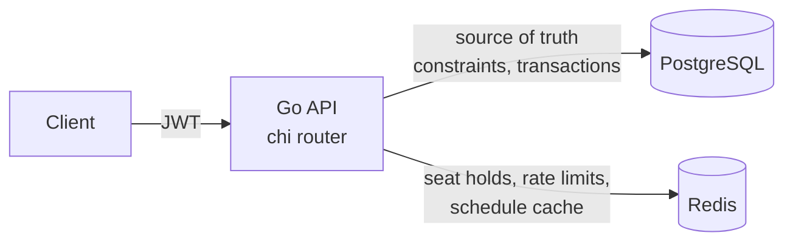
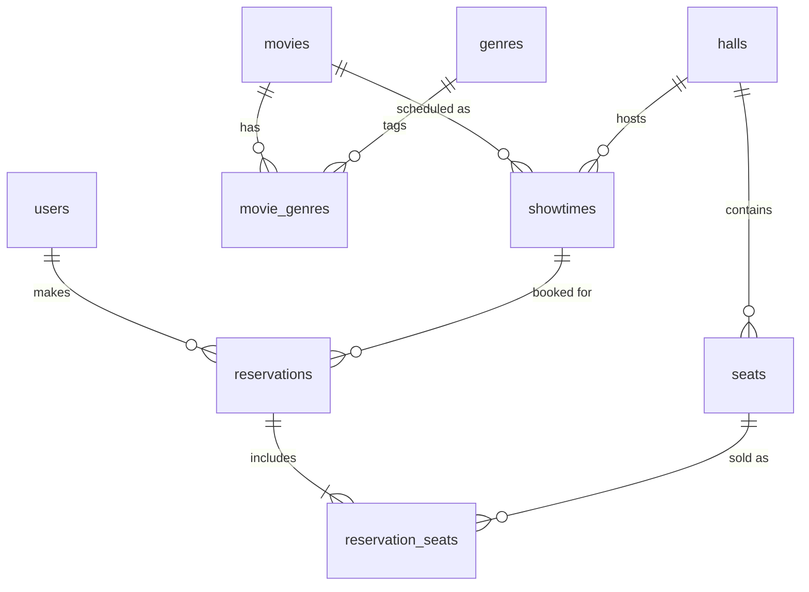

# Movie Reservation System

A movie ticket booking backend in **Go**, **PostgreSQL** and **Redis**. Users sign up, browse movies and
showtimes, hold and reserve seats, and cancel upcoming bookings. Admins manage the catalogue, the
schedule and users, and can see reservations, capacity and revenue.

Built for the [roadmap.sh Movie Reservation System](https://roadmap.sh/projects/movie-reservation-system) project.
The focus is on **correctness under concurrency**: two customers can never buy the same seat, and a
hall can never be double-scheduled. Both rules are **enforced by the database**, not only by application code.

---

## Quick start

```bash
docker compose up -d --build        # postgres + redis + api on :8080 (migrations + seed run automatically)
sh scripts/smoke.sh                 # end-to-end walkthrough of every feature (needs curl + jq)
make test                           # unit tests
make test-integration               # concurrency/integration tests against real Postgres & Redis
```

**Interactive API docs:** open **http://localhost:8080/docs**. This is a themed Swagger UI built from the
embedded OpenAPI 3 spec ([api/openapi.yaml](api/openapi.yaml), also served at `/openapi.yaml`). Its
*Quick sign-in* box logs you in and authorizes every *Try it out* request. Use *Fill demo admin*, or
*New demo user* to create a fresh customer account.

Seeded admin: `admin@cinema.local` / `Admin@12345` (set with `ADMIN_EMAIL` / `ADMIN_PASSWORD`).
The demo seed adds 10 genres, 2 halls (160 seats) and 3 movies with showtimes.

## Architecture



```
cmd/api/              entrypoint: config, wiring, graceful shutdown
internal/
  server/             all routes + auth rules in one file, request logging, health/readiness
  auth/               JWT (HS256), bcrypt, Authenticate / RequireRole middleware
  user/               signup, login, role management, admin bootstrap
  movie/              catalogue CRUD, genres, soft delete
  showtime/           halls, scheduling, day schedule (cached), seat map
  reservation/        holds, idempotent booking, cancellation   <- the core business logic
  report/             occupancy & revenue analytics (GROUPING SETS)
  holds/              atomic multi-seat holds in Redis (Lua)
  pricing/            integer-cents pricing rules
  platform/           postgres (pool, migrator, error classification), redis, rate limiter
migrations/           versioned SQL, embedded into the binary
```

The code is organised **by feature**, with a store → service → handler split. Packages that are plain
CRUD (movies) skip the service layer on purpose. Dependencies are wired by hand in `main.go`: no DI
framework and no ORM, just explicit SQL.

## Key design decisions

### 1. Preventing overbooking: two layers

| Layer | Mechanism | Purpose |
|---|---|---|
| **Redis seat hold** (soft lock, 5 min TTL) | One Lua script checks *and* sets every requested seat key, all or nothing | Good UX ("these seats are yours while you check out"), fast rejection, keeps contention away from Postgres |
| **Postgres partial unique index** (hard guarantee) | `UNIQUE (showtime_id, seat_id) WHERE active` on `reservation_seats` | Makes a double sale **impossible**, even if Redis is down, flushed, or bypassed |

The booking transaction locks the showtime row `FOR SHARE`, so it can't be cancelled while a booking
is in flight. It then checks that the seats belong to the hall, snapshots prices, and inserts all seats in
one `INSERT … SELECT unnest(...)`. A unique violation becomes a clean `409 Conflict`.

**Failure mode:** if Redis is unavailable, booking **still works**. It logs a warning and relies on the
database constraint, so correctness never depends on the cache. The rate limiter also fails open.

*Proof:* `TestNoOverbookingUnderContention` launches 50 concurrent customers at the same pair of seats
and asserts that exactly one succeeds, 49 get `409`, and exactly 2 seat rows are sold.

Why not `SELECT … FOR UPDATE` on seats, or optimistic version columns? A unique index is simpler,
lock-free for readers, and impossible to forget in a new code path.

### 2. Scheduling without overlaps

```sql
CONSTRAINT showtimes_no_overlap EXCLUDE USING gist (
    hall_id WITH =, tstzrange(starts_at, ends_at, '[)') WITH &&
) WHERE (status = 'scheduled')
```

`ends_at` is derived on the server as `starts_at + runtime + turnaround buffer` (15 min cleaning time,
configurable). Postgres rejects overlapping showtimes atomically, with no check-then-insert race.
Cancelled showtimes free their slot. Times are stored as `TIMESTAMPTZ` (UTC). A "day" is computed in
the theater's timezone (`THEATER_TIMEZONE`) with `AddDate`, so DST days are handled correctly.

### 3. Idempotent bookings

Clients send an `Idempotency-Key` header. `UNIQUE (user_id, idempotency_key)` together with
`INSERT … ON CONFLICT DO NOTHING` means a retried request (mobile network drop, double click) returns
the **original** reservation with `200` and `Idempotent-Replayed: true`. It never creates a second
booking, and concurrent duplicates are safe too.

### 4. Cancellation rules

- Users can cancel only their **own**, **upcoming** reservations, at least `CANCELLATION_CUTOFF`
  (30 min) before the start. Other users' reservations return `404`, not `403`, so their existence isn't revealed.
- The reservation row is locked `FOR UPDATE`, which serialises concurrent cancels. Seats are released by
  setting `active = false`, so history and revenue data are kept.
- When an admin cancels a showtime, all of its reservations are cancelled in the same transaction.
- A movie is soft-deleted and can't be deleted while it has scheduled showtimes.

### 5. Reporting

`GET /admin/reports/summary` returns totals, a **per-movie** breakdown and a **per-day** breakdown
(capacity, seats sold, occupancy %, revenue) from **one SQL query** using `GROUPING SETS`.
`GET /admin/reports/showtimes` lists each showtime's capacity, sold seats, available seats and revenue.
Revenue comes from the per-seat `price_cents` snapshot, so later price changes never rewrite history.

### 6. Auth and security

- bcrypt (cost 12) password hashing. Login compares against a dummy hash for unknown emails, so
  response timing doesn't reveal which emails exist.
- HS256 JWTs with issuer, expiry and algorithm pinning. RBAC is enforced by `RequireRole(admin)` on the
  whole `/admin` subtree, and every route is declared in [internal/server/router.go](internal/server/router.go).
- The bootstrap admin comes from env vars. Only admins can promote users, and admins can't demote
  themselves, so the system can't lose its last admin.
- Distributed rate limiting in Redis: 10/min on auth endpoints, 30/min on booking, per user or IP.
- Request bodies are capped at 1 MB, unknown JSON fields are rejected, all SQL is parameterised, and
  internal errors are never leaked to clients.

### 7. Operations

Structured JSON logs (`slog`) with request IDs, `/healthz` (liveness) and `/readyz` (checks Postgres and
Redis), graceful shutdown that drains in-flight requests on SIGTERM, server timeouts against slow
clients, and a 12-factor env config. Migrations are embedded and guarded by a Postgres advisory lock,
so multiple replicas can start at once safely. The image is distroless and runs as non-root. CI runs
gofmt, vet, race-enabled unit and integration tests, and a Docker build.

**Horizontal scaling:** the API is stateless. Holds, rate limits and cache live in Redis, and all
invariants are enforced in Postgres, so you can run N replicas behind a load balancer. Hold keys use a
hash tag (`hold:{st42}:seat`) so the Lua scripts also work on Redis Cluster.

## Data model



## API (`/api/v1`)

| Method | Path | Auth | Description |
|---|---|---|---|
| POST | `/auth/signup` | – | Create account |
| POST | `/auth/login` | – | Get JWT |
| GET | `/me` | user | Current user |
| GET | `/genres` | – | List genres |
| GET | `/movies?genre=&q=&limit=&offset=` | – | Browse / search movies |
| GET | `/movies/{id}` | – | Movie details |
| GET | `/halls` | – | List halls |
| GET | `/showtimes?date=YYYY-MM-DD` | – | Movies and their showtimes for a day (cached) |
| GET | `/showtimes/{id}` | – | Showtime details |
| GET | `/showtimes/{id}/seats` | optional | Seat map: `available` / `held` / `held_by_you` / `booked`, plus prices |
| POST | `/showtimes/{id}/holds` | user | Hold seats for 5 min `{"seat_ids":[1,2]}` |
| POST | `/showtimes/{id}/holds/release` | user | Release your holds |
| POST | `/reservations` | user | Book `{"showtime_id":1,"seat_ids":[1,2]}`, header `Idempotency-Key` |
| GET | `/reservations?scope=upcoming\|past` | user | My reservations |
| GET | `/reservations/{id}` | user | Reservation details |
| POST | `/reservations/{id}/cancel` | user | Cancel an upcoming reservation |
| GET | `/admin/users` | admin | List users |
| PATCH | `/admin/users/{id}/role` | admin | Promote/demote `{"role":"admin"}` |
| POST/PUT/DELETE | `/admin/movies[/{id}]` | admin | Manage movies (genres auto-created) |
| POST | `/admin/halls` | admin | Create hall `{"name","rows","seats_per_row","premium_rows"}` |
| POST | `/admin/showtimes` | admin | Schedule `{"movie_id","hall_id","starts_at","price_cents"}` |
| POST | `/admin/showtimes/{id}/cancel` | admin | Cancel showtime and all its reservations |
| GET | `/admin/reservations?showtime_id=&user_id=&status=&scope=` | admin | All reservations |
| GET | `/admin/reports/showtimes?from=&to=` | admin | Capacity, occupancy and revenue per showtime |
| GET | `/admin/reports/summary?from=&to=` | admin | Totals, by movie, by day |

Errors use one envelope: `{"error":{"code":"conflict","message":"..."}}`. The codes map to
400/401/403/404/409/429.

### Example booking flow

```bash
TOKEN=$(curl -s localhost:8080/api/v1/auth/login \
  -d '{"email":"admin@cinema.local","password":"Admin@12345"}' | jq -r .access_token)

curl -s "localhost:8080/api/v1/showtimes?date=$(date -u -d tomorrow +%F)" | jq
curl -s localhost:8080/api/v1/showtimes/1/seats -H "Authorization: Bearer $TOKEN" | jq '.seats[:3]'
curl -s localhost:8080/api/v1/showtimes/1/holds -H "Authorization: Bearer $TOKEN" -d '{"seat_ids":[1,2]}'
curl -s localhost:8080/api/v1/reservations -H "Authorization: Bearer $TOKEN" \
  -H "Idempotency-Key: $(uuidgen)" -d '{"showtime_id":1,"seat_ids":[1,2]}' | jq
```

## Configuration

See [.env.example](.env.example). Main settings: `DATABASE_URL`, `REDIS_ADDR`, `JWT_SECRET`
(32+ characters), `THEATER_TIMEZONE`, `SEAT_HOLD_TTL`, `CANCELLATION_CUTOFF`, `TURNAROUND_BUFFER`.

## Possible extensions

Payment integration with a `pending → confirmed` state and hold-until-paid (a transactional outbox to
the payment provider), email notifications through an outbox worker, refresh tokens and revocation,
OpenTelemetry tracing and Prometheus metrics, cursor pagination, and an OpenAPI spec.
